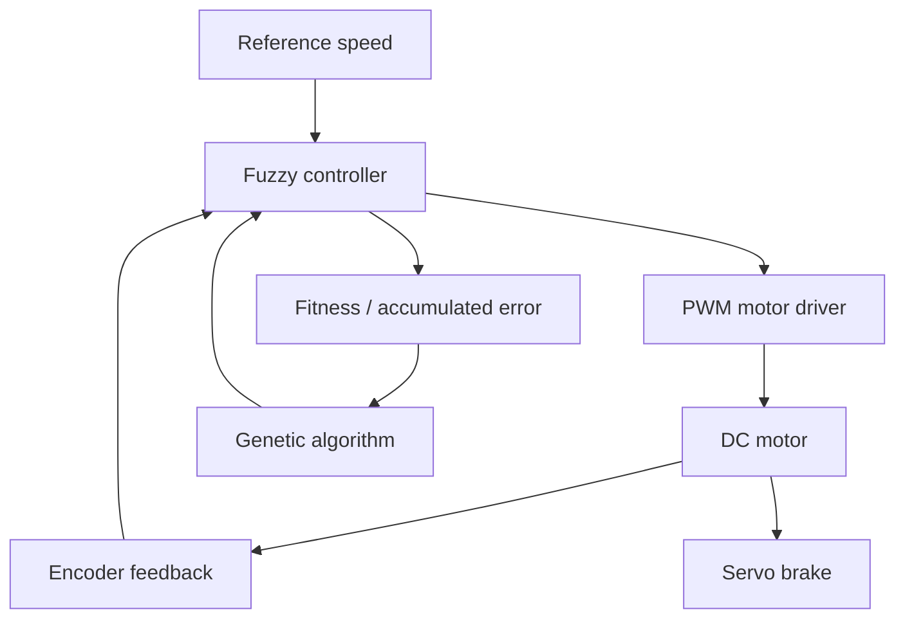

# Genetic Algorithm Tuned Fuzzy Controller

**An ESP32 motor-control experiment combining fuzzy logic, evolutionary tuning, and an automated brake.**

## Contents

- [Overview](#overview)
- [System architecture](#system-architecture)
- [Experiment configuration](#experiment-configuration)
- [Hardware pinout](#hardware-pinout)
- [Requirements](#requirements)
- [Setup](#setup)
- [Experimental procedure](#experimental-procedure)
- [Safety and limitations](#safety-and-limitations)
- [License](#license)

## Overview

This project combines a fuzzy-logic controller with a genetic algorithm that searches for membership-function centroid configurations. The experimental setup controls a DC motor and uses a servo-actuated brake to make repeated tests more consistent.

The current sketch configures a population of 20 individuals, runs an evolutionary loop for up to 50 generations, and evaluates each individual against the motor test bench.

## System architecture

The diagram summarizes the experiment's intended relationship between the controller, motor bench, feedback, and evolutionary tuning.

## Experiment configuration

Values defined in the sketch include:

| Parameter | Value |
|---|---:|
| Population size | 20 |
| Maximum generation index | 50 |
| Mutation setting passed to GA | 10 |
| Sampling interval | 80 ms |
| PWM frequency | 1 kHz |
| PWM resolution | 10 bits |
| Encoder pulses per revolution | 3 |

The source passes `10` as the genetic algorithm's mutation setting and comments it as a 10% mutation chance. Confirm the library's interpretation before changing it.

## Hardware pinout

| Signal | ESP32 GPIO |
|---|---:|
| Motor PWM | 25 |
| Motor direction | 33 |
| Encoder | 22 |
| Brake servo | 32 |

The sketch uses `ESP32Servo` and the ESP32 LEDC PWM interface.

## Requirements

- ESP32 development board
- DC motor and compatible driver
- Encoder matching the pulse configuration
- Servo and mechanical brake assembly
- Arduino-compatible ESP32 toolchain
- `ESP32Servo` library

## Setup

1. Clone the repository.
2. Open `FUZZY_Controller_GA.ino` in the Arduino IDE.
3. Install the required ESP32 board support and `ESP32Servo`.
4. Inspect the implementation under `src/`.
5. Verify motor-driver wiring, encoder signal levels, servo travel, and power supply.
6. Upload only after confirming the hardware configuration and safe operating limits.

The sketch uses LEDC APIs associated with particular ESP32 Arduino-core versions; check compatibility with your installed core.

## Experimental procedure

The sketch runs each individual on the motor bench, accumulates error and control effort, and then calls the genetic algorithm's iteration method. The brake servo is used to stop the motor between trials.

For meaningful comparisons, log the reference profile, controller parameters, measured speed, accumulated error, control effort, generation, and individual index.

## Safety and limitations

A motor and mechanical brake can create pinch, heat, and electrical hazards. Begin with conservative PWM limits, a secure test fixture, a physical emergency stop, and a current-limited supply. Do not run the mechanism unattended.

This is an experimental controller, not a safety-certified motor-control system.

## License

No `LICENSE` file is currently included. Unless a license is added, reuse and redistribution permissions are not granted by this repository.
